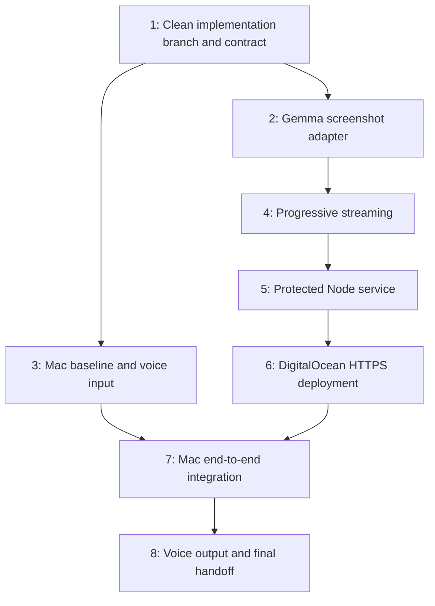

# Implementation plan: general-purpose Clicky with Gemma and DigitalOcean

## Outcome

A teammate runs native Clicky on macOS, asks about the current screen, and receives a progressive Gemma response with a sensible pointer target. DigitalOcean hosts the authenticated HTTPS backend. Get general-purpose behavior working before student-specific features.

Planning only: no application implementation or cloud provisioning is performed by this plan. Tasks are tracked in `tasks/todo.md`. Estimates are engineering estimates, not completion promises.

## Verified baseline

- macOS SwiftUI/AppKit source; teammate must build in Xcode GUI on macOS 14.2+. No terminal xcodebuild per repository instructions.
- `worker/src/index.ts` currently proxies Anthropic, ElevenLabs, and AssemblyAI. No Node production entry point, request authentication, or deployed DigitalOcean backend exists.
- `ClaudeAPI.swift` sends Anthropic-shaped messages, system text and base64 images; streaming parser consumes content_block_delta/text_delta SSE events.
- Hosted `gemma-4-26b-a4b-it` passed a separate text-only API request. Screenshot input, streaming and coordinate accuracy remain unverified.
- DigitalOcean plugin read-only account access verified. No Droplet provisioned by this chat. No paid resource budget has been selected.
- Team repository: https://github.com/omariomari2/hacktoberfest. Published main starts at clean snapshot 64fb7fa; original local main contains upstream history with a blocked historical secret.

## Architecture decisions

1. Preserve the existing Swift chat protocol through a backend adapter. Pin the upstream model to Gemma rather than trusting the client's Claude model name. Show the actual provider/model in the UI.
2. Translate text/history/image blocks to Gemini contents and translate responses to the Swift client's existing SSE and nonstreaming shapes. Validate model support for system instructions before choosing an encoding; if needed prepend trusted instructions to content. Never expose model thought parts as response text.
3. Use a normal Node HTTP service with streaming, health checks and environment secrets on DigitalOcean. A Droplet is compatible with the available plugin, but select region, size, HTTPS hostname and approved cost before provisioning. Do not assume App Platform tooling is connected.
4. Use a temporary per-team app token for the demo, configured locally on the Mac and compared server-side. Keep it and GEMINI_API_KEY out of committed files. This is a demo access control, not production user identity management.
5. Voice is a separate dependency. Prefer testing the existing Apple Speech input provider on Mac to avoid adding another account. Implement normal-response native speech fallback if ElevenLabs is unavailable; the current hardcoded error speech is not such a fallback.

## Dependency graph and parallel ownership

This PC owns tasks 1, 2, 4, 5, 6 and backend verification. The Mac teammate owns tasks 3, Mac portions of 7, and 8. Freeze API/auth contracts in task 1 before parallel edits. Coordinate ownership of CompanionManager.swift to avoid overlapping changes. Do not spawn additional agents merely because the work is parallelizable.

## Ordered milestones

- Tasks 1–3: real screenshot input produces useful Gemma output; Mac shell builds independently.
- Tasks 4–5: progressive protocol-compatible responses through a protected local service.
- Tasks 6–8: public HTTPS backend, real Mac screen interaction, then usable voice output and repeatable teammate setup.

Checkpoint after tasks 2–3: review screenshot response and Mac build evidence. If either fails, resolve it before deployment.
Checkpoint after tasks 4–5: review stream/error handling, secret isolation and rejected unauthenticated requests before provisioning.
Final checkpoint: demonstrate three successive real Mac interactions with correct model, response, pointer and recoverable errors.

## Scope boundaries

Do not add student specialization, autonomous clicking, Windows porting, user accounts, analytics dashboards, production release signing or model downloads. Do not repair Snowflake MCP. Defer Snowflake application persistence until the base flow works, consistent with the user's latest priority; existing project rules about Snowflake's core role need alignment before that integration stage.

## Risks and decisions

| Risk / unknown | Approach |
| --- | --- |
| Mac baseline untested | Teammate begins task 3 immediately after contract handoff |
| Gemma image or SSE incompatibility | Real image request and chunk-boundary tests before deployment |
| Model coordinate errors | One display first; bounded coordinates; validate on known targets, no autonomous clicks |
| Quota errors or latency | Surface 429/timeout clearly, bounded requests; do not silently switch models |
| No confirmed speech-service keys | Apple Speech test, native speech fallback; avoid new provider dependencies |
| Public proxy abuse / screen privacy | Auth, body/image limits, concurrency/timeouts; no screenshot/transcript payload logging |
| HTTPS / deployment cost | Choose hostname or managed HTTPS approach and cost with user before provisioning |
| Upstream history secret | Branch from published hackathon main, never merge original local main history |

## Open configuration decisions

- Mac teammate confirms Xcode readiness and Apple Speech transcription.
- User chooses DigitalOcean resource budget and HTTPS hostname approach before task 6.
- Securely supply backend GEMINI_API_KEY and shared demo token; no secrets in chat.

## Estimated effort

Backend local milestones: roughly 90–150 minutes. Deployment: roughly 30–60 minutes once credentials, cost and DNS are ready. Mac setup/integration/voice: roughly 45–90 minutes, partly parallel. Reassess against the event deadline before each checkpoint; never substitute mocked success for a verified flow.
